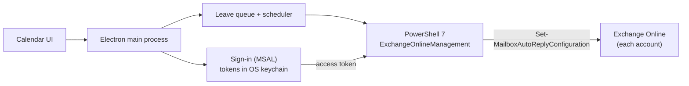

<div align="center">


# OOO Scheduler

**Set your out-of-office on every Microsoft 365 account at once.**

[](https://github.com/guranshdeol/out-of-office-scheduler/releases/latest)

[](LICENSE)

[Download](https://github.com/guranshdeol/out-of-office-scheduler/releases/latest) · [Website](https://guranshdeol.github.io/out-of-office-scheduler/) · [Install](#install) · [For IT teams](#for-it-and-security-teams)


</div>

---

## Watch it in action

https://github.com/user-attachments/assets/e025628a-dbfd-4e26-8349-5f79feb45055

---

## What it does

If you work in more than one company mailbox, every leave means setting the same auto-reply and calendar block in each one, by hand.

OOO Scheduler does it in one go: **click the days you'll be away, press Apply**, and every connected account gets the out-of-office reply and an *Out of office* calendar block.

- **Every account at once.** Your employer's and your clients' Microsoft 365 accounts.
- **Separate weeks.** Pick days across different weeks; later leave waits in a queue and goes live after the earlier leave ends, while the app is running.
- **One message.** Write `{end}` and each leave fills in its own last day, for example *"until Friday, 24 October"*.
- **Your company's sign-in.** Okta, Microsoft Entra and other SSO. You sign in once per account.
- **No admin rights, no server.** The app talks only to Microsoft.

---

<a id="installing"></a>

## Install

### 1. Download

From the [latest release](https://github.com/guranshdeol/out-of-office-scheduler/releases/latest), choose the file for your computer:

| Computer | File |
|---|---|
| Mac with Apple Silicon (M1 or newer) | `…-mac-arm64.dmg` |
| Mac with Intel | `…-mac-x64.dmg` |
| Windows | `…-win-x64-setup.exe` |
| Linux | `.AppImage` or `.deb` |

### 2. Open it the first time

The app isn't code-signed yet, so your computer asks you to confirm the first launch.

<a id="opening-it-on-macos"></a>

<details open>
<summary><b>macOS</b></summary>

<br>

1. Open the `.dmg` and drag **OOO Scheduler** into **Applications**.
2. **Only if your Mac account isn't an administrator:** verify the download, then remove macOS's download flag.
   - Download **`SHA256SUMS.txt`** from the same release into the same folder as the `.dmg`.
   - In Terminal, run (use `mac-x64.dmg` on an Intel Mac):

     ```bash
     cd ~/Downloads
     grep "mac-arm64.dmg" SHA256SUMS.txt | shasum -a 256 -c
     ```

   - **Continue only if it prints `OK`.** If it prints `FAILED`, delete the file and download it again.
   - Then run:

     ```bash
     xattr -d com.apple.quarantine "/Applications/OOO Scheduler.app"
     ```

3. Open the app. When macOS says it *could not verify* it, click **Done** (not *Move to Trash*).
4. Go to **System Settings → Privacy & Security**, click **Open Anyway**, and enter your password if asked.
5. If macOS asks to use *"OOO Scheduler Safe Storage"*, click **Always Allow**. This can come back after updates.

On a company-managed Mac, follow your IT team's policy for installing apps.

</details>

<details>
<summary><b>Windows</b></summary>

<br>

Run the `-setup.exe`. If SmartScreen appears, click **More info → Run anyway**.

</details>

<details>
<summary><b>Linux</b></summary>

<br>

Run the `.AppImage` (make it executable first) or install the `.deb`. A keyring such as GNOME Keyring or KWallet is needed to store sign-ins.

</details>

### 3. Set it up

1. The first launch sets itself up (it downloads PowerShell 7 if needed). This takes a minute.
2. **Accounts:** connect each mailbox. Your browser opens once for that company's sign-in.
3. **Message & settings:** write your message, and keep **Start at login** on.
4. **Calendar:** click your leave days and press **Apply**.

---

## Good to know

- **Microsoft 365 only.** Gmail and on-premises Exchange aren't supported.
- **Your company still decides.** Some companies block the Exchange Online PowerShell route; **Test connection** shows whether an account works.
- **Keep the app running.** Outlook holds one scheduled period per mailbox, so later leave goes live only if the app runs at some point in between.
- **Cancelling leave** turns the reply off, but the calendar block stays. The app gives you a link to delete it in Outlook.
- **Use your normal mailboxes,** never an administrator account, and check that your company's and clients' policies allow it.

---

## For IT and security teams

<details>
<summary>What the app does, stores and connects to</summary>

<br>

OOO Scheduler is open source, so everything below can be checked in the code.

- **What it changes.** Only the signed-in user's own automatic replies and the matching *Out of office* calendar block. Each session loads just two cmdlets: `Get-MailboxAutoReplyConfiguration` and `Set-MailboxAutoReplyConfiguration` (with `-CreateOOFEvent` for the calendar block).
- **Permissions.** The user signs in through Microsoft's own Exchange Online PowerShell public client (`fb78d390-0c51-40cd-8e17-fdbfab77341b`) in the system browser, with the company's usual SSO and MFA. There's no app registration and no admin consent. The app acts with the user's own Exchange Online rights. A tenant that blocks Exchange Online PowerShell for users also blocks the app.
- **What's stored.** In the app's data folder (`~/Library/Application Support/OOO Scheduler`, `%APPDATA%\OOO Scheduler` or `~/.config/OOO Scheduler`): the MSAL token cache, encrypted with the OS (Keychain, DPAPI or libsecret) and readable only by the user; and a settings file with account addresses, nicknames, the message and leave dates. Removing an account deletes its saved sign-in.
- **Network.** `github.com` and its download CDN (first-run PowerShell 7 download), `api.github.com` (daily check for a newer release, which users can switch off), the PowerShell Gallery (`ExchangeOnlineManagement` module), `login.microsoftonline.com` (sign-in) and `outlook.office365.com` (Exchange Online). No telemetry.
- **Processes.** Bundled scripts run in a separate `pwsh` process; on Windows it starts with `-ExecutionPolicy Bypass` so those scripts can run. The access token is passed over stdin, never on the command line.
- **Builds.** Built by GitHub Actions from this repository. Each release includes `SHA256SUMS.txt` and a build attestation (`gh attestation verify <file> --repo guranshdeol/out-of-office-scheduler`). The builds aren't code-signed yet.
- **Updates.** The app never downloads or installs updates by itself. It only tells the user that a newer release exists.

</details>

---

## How it works

<details>
<summary>Architecture</summary>

<br>



The app uses **Exchange Online PowerShell**, the same supported tool admins use, to set the user's own automatic replies. It works with ordinary user permissions in most companies, even ones that block third-party Microsoft Graph apps. Every request goes straight from the computer to Microsoft.

</details>

---

## Development

<details>
<summary>Build and run from source</summary>

<br>

```bash
git clone https://github.com/guranshdeol/out-of-office-scheduler.git
cd out-of-office-scheduler
npm install
npm run electron:install   # downloads the Electron binary if npm skipped install scripts
npm run dev                # run with hot reload
```

| Command | What it does |
|---|---|
| `npm run dev` | Start the app in development mode |
| `npm test` | Run unit tests (Vitest) |
| `npm run typecheck` | Type-check the main process and the UI |
| `npm run dist:mac` | Build the macOS `.dmg` files locally |

Behind a corporate TLS-inspecting proxy, prefix npm and build commands with `NODE_USE_SYSTEM_CA=1`.

```
src/
  main/        Electron main process: sign-in, scheduler, PowerShell runner, tray
  preload/     Safe bridge between the UI and the main process
  renderer/    React UI (calendar, accounts, message)
  shared/      Types and date helpers used by both sides
resources/
  scripts/     PowerShell scripts that talk to Exchange Online
tests/         Unit tests
```

**Releasing:** bump the version and push a tag; GitHub Actions builds the installers and publishes the release.

```bash
npm version patch          # or minor / major
git push --follow-tags
```

</details>

---

## Credits and license

App icon based on [Lucide](https://lucide.dev) *calendar-clock* (ISC License). Built with [Electron](https://www.electronjs.org), [React](https://react.dev), [electron-vite](https://electron-vite.org) and [MSAL Node](https://github.com/AzureAD/microsoft-authentication-library-for-js).

[MIT](LICENSE) © 2026 Guransh Deol
