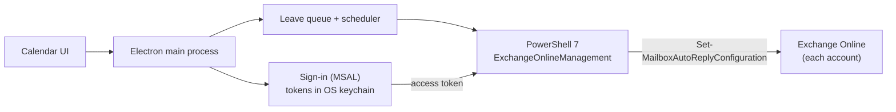

<div align="center">


# OOO Scheduler

**Pick your leave days once. Every Microsoft 365 account you work in gets its out-of-office reply and calendar block.**

[](https://github.com/guranshdeol/out-of-office-scheduler/actions/workflows/build.yml)
[](https://github.com/guranshdeol/out-of-office-scheduler/releases/latest)

[](LICENSE)

[Website](https://guranshdeol.github.io/out-of-office-scheduler/) · [Download](https://github.com/guranshdeol/out-of-office-scheduler/releases/latest) · [How it works](#how-it-works) · [Installing](#installing) · [Development](#development)


</div>

**▶ 72-second walkthrough**


https://github.com/user-attachments/assets/e025628a-dbfd-4e26-8349-5f79feb45055


---

## Why

If you're a contractor or consultant, you probably have more than one work mailbox: your employer's and one for each client. Every time you take leave, you set the same out-of-office reply and calendar block in each of them, by hand.

OOO Scheduler does it from one place. Click the days you'll be away, press **Apply**, and every connected account is updated.

## Features

- **One calendar, every account.** Connect your employer's and your clients' Microsoft 365 accounts and apply leave to all of them at once.
- **Separate stretches of leave.** Pick days across different weeks. Days in a row, and the weekends between them, are grouped into one period automatically.
- **Hands-off queue.** Outlook can hold only one scheduled out-of-office period, so the app sets the first stretch straight away and applies each later stretch from the menu bar once the earlier one ends.
- **Works with your company's sign-in.** Okta, Microsoft Entra and other single sign-on all work. You sign in once per account, and the session is stored encrypted in your OS keychain.
- **Calendar blocks.** The app adds an *Out of office* event to your calendar for each stretch. Past leave keeps its block.
- **Custom times when you need them.** By default leave runs from 12:00 AM to 12:00 AM local time. You can switch to custom start and end times, for example 12 PM to 12 PM.
- **One message, with exceptions.** Write one reply for everyone, or give a client its own text, for example with a different backup contact.
- **Dates filled in for you.** Write `{start}` and `{end}` in your message, and each leave fills in its own first and last day, for example *"I'm on leave until Friday, 24 October."*
- **Update check.** Once a day the app checks GitHub for a newer release and shows a link to download it. You can switch this off.
- **No admin rights.** On first run the app downloads PowerShell 7 and the Exchange Online module into its own folder.

<table>
  <tr>
    <td></td>
    <td></td>
  </tr>
  <tr>
    <td align="center"><sub>Connect as many accounts as you need</sub></td>
    <td align="center"><sub>One message, plus calendar settings</sub></td>
  </tr>
</table>

## How it works



- The app uses **Exchange Online PowerShell**, the same supported tool admins use, to set your own mailbox's automatic replies (`Set-MailboxAutoReplyConfiguration`). It works with ordinary user permissions in most companies, even ones that block third-party Microsoft Graph apps.
- Signing in uses the Exchange Online PowerShell public client through MSAL, in your system browser. Only the refresh token is stored, encrypted by the OS: Keychain on macOS, DPAPI on Windows, libsecret on Linux.
- Every request goes straight from your computer to Microsoft. There's no server in between, and no analytics.

## Installing

Download the file for your platform from the [latest release](https://github.com/guranshdeol/out-of-office-scheduler/releases/latest).

| Platform | File | First launch |
|---|---|---|
| macOS (Apple Silicon) | `…-mac-arm64.dmg` | Drag the app to Applications, then see [Opening it on macOS](#opening-it-on-macos). |
| macOS (Intel) | `…-mac-x64.dmg` | Same as above. |
| Windows | `…-win-x64-setup.exe` | If SmartScreen appears, click **More info → Run anyway**. |
| Linux | `.AppImage` or `.deb` | Needs a keyring (GNOME Keyring or KWallet) so sign-ins can be stored securely. |

### Opening it on macOS

The builds aren't signed with an Apple Developer ID yet, so the first time you open the app, macOS says it *could not verify "OOO Scheduler.app"*. Click **Done** (not *Move to Trash*), then use one of these:

**Option 1: Open Anyway (needs an administrator password)**

1. Open **System Settings → Privacy & Security** and scroll down to the message about *OOO Scheduler.app*.
2. Click **Open Anyway**, enter an administrator name and password, then click **Open**.

**Option 2: without administrator rights, verify the download, then allow it**

1. From the same release, also download **`SHA256SUMS.txt`** into the folder with the `.dmg` (usually Downloads).
2. In Terminal, check the download (use `mac-x64.dmg` instead on an Intel Mac):

   ```bash
   cd ~/Downloads
   grep "mac-arm64.dmg" SHA256SUMS.txt | shasum -a 256 -c
   ```

   Continue only if it prints `…mac-arm64.dmg: OK`. If it says `FAILED` or can't find the file, delete the download and download it again from the release page. For a stronger check that the file was built by this repository's release workflow, you can also run `gh attestation verify <file>.dmg --repo guranshdeol/out-of-office-scheduler` with the [GitHub CLI](https://cli.github.com).
3. Drag the app to Applications, then remove macOS's download flag from it:

   ```bash
   xattr -d com.apple.quarantine "/Applications/OOO Scheduler.app"
   ```

4. Open the app as usual.

Only do this for a download that passed the check. On a company-managed Mac, follow your IT team's policy for installing apps.

**About the Keychain prompt on macOS:** after an update, macOS may ask for permission to use *"OOO Scheduler Safe Storage"*. Click **Always Allow**. This happens because the builds aren't code-signed yet, so each version has a new signature.

### First run

1. On first launch the app sets itself up. It downloads PowerShell 7 if it isn't installed, and installs the `ExchangeOnlineManagement` module for your user.
2. **Accounts → Connect** each mailbox. Your browser opens once for that company's sign-in.
3. **Message & settings**: write your out-of-office message.
4. **Calendar**: click your leave days and press **Apply**.

## Good to know

- **Microsoft 365 only.** It works with Exchange Online work and school mailboxes. Gmail and on-premises Exchange aren't supported.
- **Your company still decides.** A tenant can block Exchange Online PowerShell for regular users or force frequent sign-in. **Test connection** shows whether an account works.
- **One period at a time.** Outlook stores one scheduled out-of-office period per mailbox. Later stretches go live once the earlier one ends, so the app needs to be running, in the menu bar, at some point in between.
- **Cancelled leave.** Exchange PowerShell can't delete calendar items. If you cancel leave that's already set and nothing else is queued, the app turns the reply off and gives you a one-click link to delete the block in Outlook.

## For IT and security teams

OOO Scheduler is open source, so everything below can be checked in the code.

- **What it changes.** Only the signed-in user's own automatic replies and the matching *Out of office* calendar block. Each session loads just two cmdlets: `Get-MailboxAutoReplyConfiguration` and `Set-MailboxAutoReplyConfiguration` (with `-CreateOOFEvent` for the calendar block).
- **Permissions.** The user signs in through Microsoft's own Exchange Online PowerShell public client (`fb78d390-0c51-40cd-8e17-fdbfab77341b`) in the system browser, with the company's usual SSO and MFA. There's no app registration and no admin consent. The app acts with the user's own Exchange Online rights. A tenant that blocks Exchange Online PowerShell for users also blocks the app.
- **What's stored.** In the app's data folder (`~/Library/Application Support/OOO Scheduler`, `%APPDATA%\OOO Scheduler` or `~/.config/OOO Scheduler`):
  - the MSAL token cache, encrypted with the OS (Keychain on macOS, DPAPI on Windows, libsecret on Linux) and readable only by the user;
  - a settings file with account addresses, nicknames, the message and leave dates.

  Removing an account deletes its saved sign-in. Sessions follow the tenant's sign-in policies and can be revoked like any other Microsoft 365 session.
- **Network.** `github.com` and its download CDN (first-run PowerShell 7 download), `api.github.com` (daily check for a newer release, which users can switch off), the PowerShell Gallery (`ExchangeOnlineManagement` module), `login.microsoftonline.com` (sign-in) and `outlook.office365.com` (Exchange Online). No other servers, and no telemetry.
- **Processes.** The app runs its bundled scripts in a separate `pwsh` process; on Windows it starts it with `-ExecutionPolicy Bypass` so those scripts can run. The access token is passed over stdin, never on the command line.
- **Builds.** Release builds are made by GitHub Actions from this repository. Each release includes `SHA256SUMS.txt` and a GitHub build attestation, so a download can be checked with `gh attestation verify <file> --repo guranshdeol/out-of-office-scheduler`. The builds aren't code-signed yet, so macOS and Windows show a warning the first time.
- **Updates.** The app never downloads or installs updates by itself. It only tells the user that a newer release exists.

**For users:** connect your normal work mailboxes only, never an administrator account. Before connecting a company's or client's mailbox, check that their policies allow it.

## Development

```bash
git clone https://github.com/guranshdeol/out-of-office-scheduler.git
cd out-of-office-scheduler
npm install
npm run electron:install   # downloads the Electron binary if npm skipped install scripts
npm run dev                # run with hot reload
```

| Command | What it does |
|---|---|
| `npm run dev` | Start the app in development mode |
| `npm test` | Run unit tests (Vitest) |
| `npm run typecheck` | Type-check the main process and the UI |
| `npm run dist:mac` | Build the macOS `.dmg` files locally |

Behind a corporate TLS-inspecting proxy, prefix npm and build commands with `NODE_USE_SYSTEM_CA=1` so Node trusts your OS certificate store.

### Project layout

```
src/
  main/        Electron main process: sign-in, scheduler, PowerShell runner, tray
  preload/     Safe bridge between the UI and the main process
  renderer/    React UI (calendar, accounts, message)
  shared/      Types and date helpers used by both sides
resources/
  scripts/     PowerShell scripts that talk to Exchange Online
tests/         Unit tests
```

### Releasing

Push a version tag. GitHub Actions builds macOS, Windows and Linux installers and publishes them on the Releases page:

```bash
npm version patch          # or minor / major
git push --follow-tags
```

## Credits

- App icon based on [Lucide](https://lucide.dev) *calendar-clock* (ISC License).
- Built with [Electron](https://www.electronjs.org), [React](https://react.dev), [electron-vite](https://electron-vite.org) and [MSAL Node](https://github.com/AzureAD/microsoft-authentication-library-for-js).

## License

[MIT](LICENSE) © 2026 Guransh Deol
