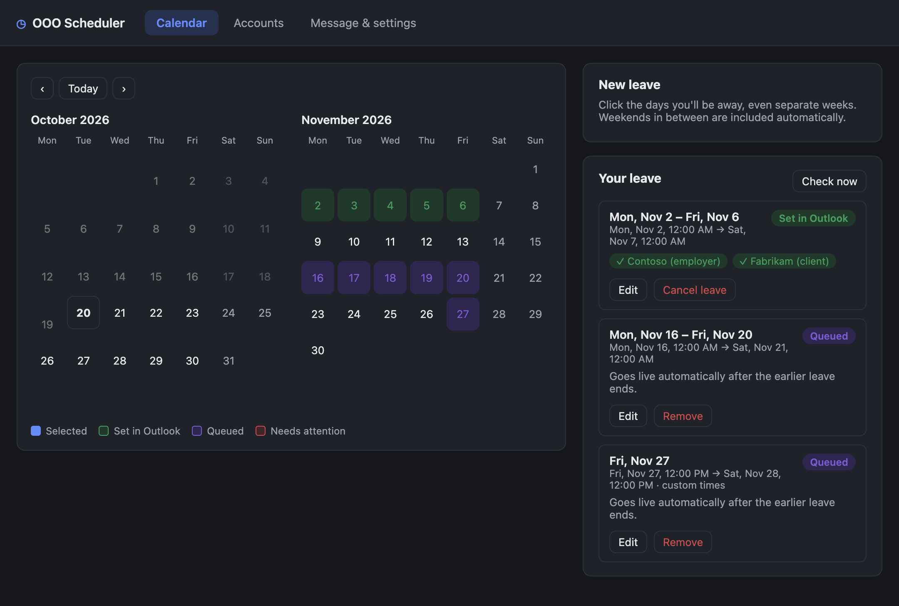
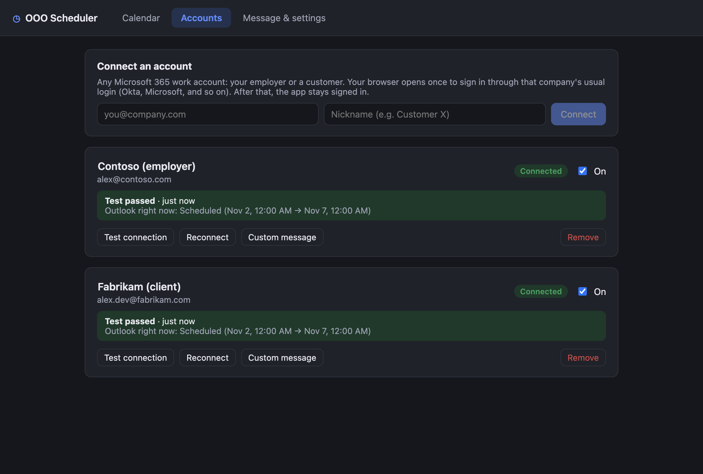
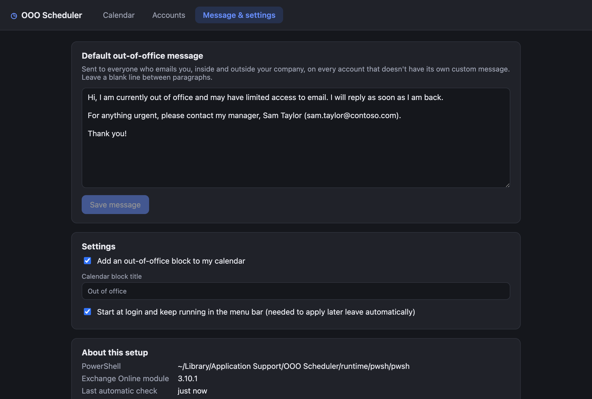
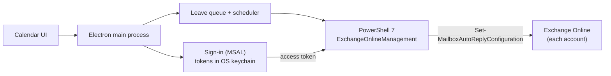

<div align="center">


# OOO Scheduler

**Pick your leave days once. Every Microsoft 365 account you work in gets its out-of-office reply and calendar block.**

[](https://github.com/guranshdeol/out-of-office-scheduler/actions/workflows/build.yml)
[](https://github.com/guranshdeol/out-of-office-scheduler/releases/latest)

[](LICENSE)

[Download](https://github.com/guranshdeol/out-of-office-scheduler/releases/latest) · [How it works](#how-it-works) · [Installing](#installing) · [Development](#development)



</div>

---

## Why

If you're a contractor or consultant, you probably have more than one work mailbox: your employer's and one for each client. Every time you take leave, you set the same out-of-office reply and calendar block in each of them, by hand.

OOO Scheduler does it from one place. Click the days you'll be away, press **Apply**, and every connected account is updated.

## Features

- **One calendar, every account.** Connect your employer's and your clients' Microsoft 365 accounts and apply leave to all of them at once.
- **Separate stretches of leave.** Pick days across different weeks. Days in a row, and the weekends between them, are grouped into one period automatically.
- **Hands-off queue.** Outlook can hold only one scheduled out-of-office period, so the app sets the first stretch straight away and applies each later stretch from the menu bar once the earlier one ends.
- **Works with your company's sign-in.** Okta, Microsoft Entra and other single sign-on all work. You sign in once per account, and the session is stored encrypted in your OS keychain.
- **Calendar blocks.** The app adds an *Out of office* event to your calendar for each stretch. Past leave keeps its block.
- **Custom times when you need them.** By default leave runs from 12:00 AM to 12:00 AM local time. You can switch to custom start and end times, for example 12 PM to 12 PM.
- **One message, with exceptions.** Write one reply for everyone, or give a client its own text, for example with a different backup contact.
- **No admin rights.** On first run the app downloads PowerShell 7 and the Exchange Online module into its own folder.

<table>
  <tr>
    <td></td>
    <td></td>
  </tr>
  <tr>
    <td align="center"><sub>Connect as many accounts as you need</sub></td>
    <td align="center"><sub>One message, plus calendar settings</sub></td>
  </tr>
</table>

## How it works



- The app uses **Exchange Online PowerShell**, the same supported tool admins use, to set your own mailbox's automatic replies (`Set-MailboxAutoReplyConfiguration`). It works with ordinary user permissions in most companies, even ones that block third-party Microsoft Graph apps.
- Signing in uses the Exchange Online PowerShell public client through MSAL, in your system browser. Only the refresh token is stored, encrypted by the OS: Keychain on macOS, DPAPI on Windows, libsecret on Linux.
- Every request goes straight from your computer to Microsoft. There's no server in between, and no analytics.

## Installing

Download the file for your platform from the [latest release](https://github.com/guranshdeol/out-of-office-scheduler/releases/latest).

| Platform | File | First launch |
|---|---|---|
| macOS (Apple Silicon) | `…-mac-arm64.dmg` | Drag the app to Applications, then **right-click → Open** the first time (the build isn't notarized). |
| macOS (Intel) | `…-mac-x64.dmg` | Same as above. |
| Windows | `…-win-x64-setup.exe` | If SmartScreen appears, click **More info → Run anyway**. |
| Linux | `.AppImage` or `.deb` | Needs a keyring (GNOME Keyring or KWallet) so sign-ins can be stored securely. |

**About the Keychain prompt on macOS:** after an update, macOS may ask for permission to use *"OOO Scheduler Safe Storage"*. Click **Always Allow**. This happens because the builds aren't code-signed yet, so each version has a new signature.

### First run

1. On first launch the app sets itself up. It downloads PowerShell 7 if it isn't installed, and installs the `ExchangeOnlineManagement` module for your user.
2. **Accounts → Connect** each mailbox. Your browser opens once for that company's sign-in.
3. **Message & settings**: write your out-of-office message.
4. **Calendar**: click your leave days and press **Apply**.

## Good to know

- **Microsoft 365 only.** It works with Exchange Online work and school mailboxes. Gmail and on-premises Exchange aren't supported.
- **Your company still decides.** A tenant can block Exchange Online PowerShell for regular users or force frequent sign-in. **Test connection** shows whether an account works.
- **One period at a time.** Outlook stores one scheduled out-of-office period per mailbox. Later stretches go live once the earlier one ends, so the app needs to be running, in the menu bar, at some point in between.
- **Cancelled leave.** Exchange PowerShell can't delete calendar items. If you cancel leave that's already set and nothing else is queued, the app turns the reply off and gives you a one-click link to delete the block in Outlook.

## Development

```bash
git clone https://github.com/guranshdeol/out-of-office-scheduler.git
cd out-of-office-scheduler
npm install
npm run electron:install   # downloads the Electron binary if npm skipped install scripts
npm run dev                # run with hot reload
```

| Command | What it does |
|---|---|
| `npm run dev` | Start the app in development mode |
| `npm test` | Run unit tests (Vitest) |
| `npm run typecheck` | Type-check the main process and the UI |
| `npm run dist:mac` | Build the macOS `.dmg` files locally |

Behind a corporate TLS-inspecting proxy, prefix npm and build commands with `NODE_USE_SYSTEM_CA=1` so Node trusts your OS certificate store.

### Project layout

```
src/
  main/        Electron main process: sign-in, scheduler, PowerShell runner, tray
  preload/     Safe bridge between the UI and the main process
  renderer/    React UI (calendar, accounts, message)
  shared/      Types and date helpers used by both sides
resources/
  scripts/     PowerShell scripts that talk to Exchange Online
tests/         Unit tests
```

### Releasing

Push a version tag. GitHub Actions builds macOS, Windows and Linux installers and publishes them on the Releases page:

```bash
npm version patch          # or minor / major
git push --follow-tags
```

## Credits

- App icon based on [Lucide](https://lucide.dev) *calendar-clock* (ISC License).
- Built with [Electron](https://www.electronjs.org), [React](https://react.dev), [electron-vite](https://electron-vite.org) and [MSAL Node](https://github.com/AzureAD/microsoft-authentication-library-for-js).

## License

[MIT](LICENSE) © 2026 Guransh Deol
